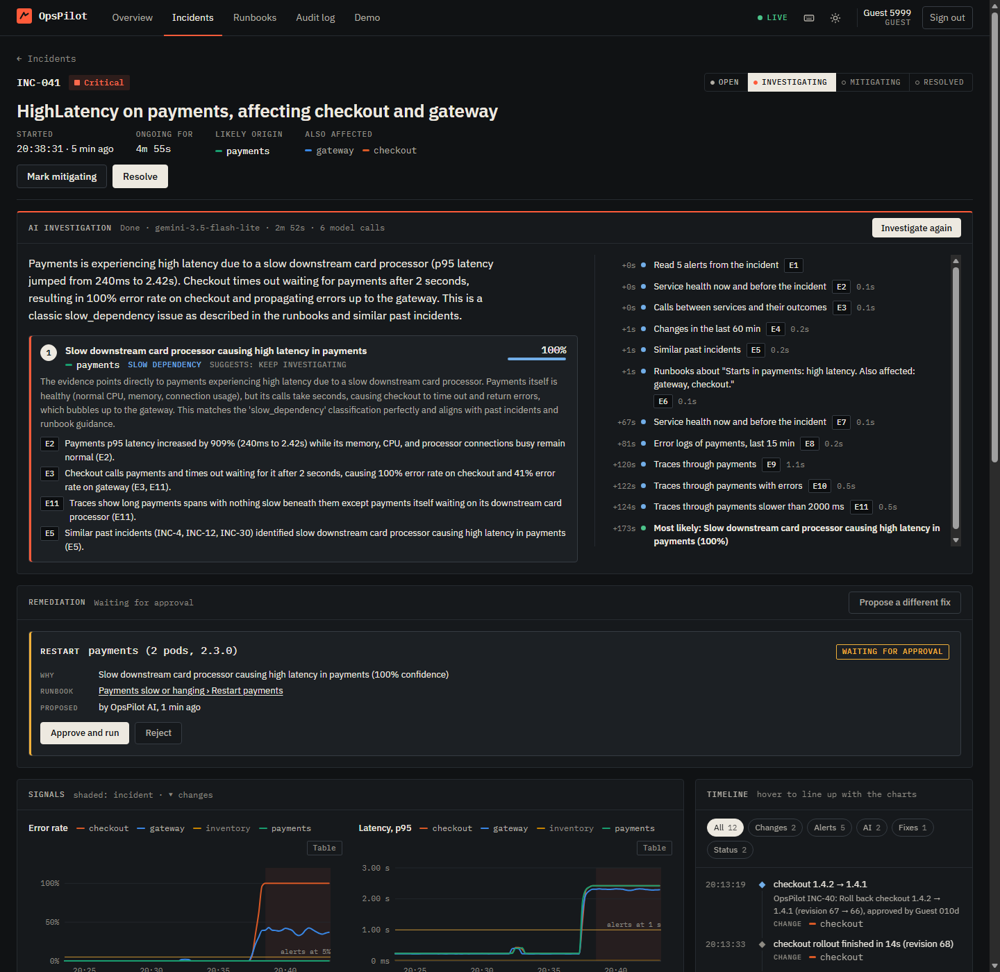
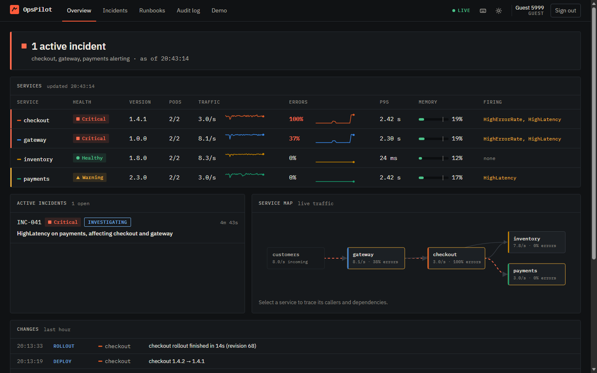
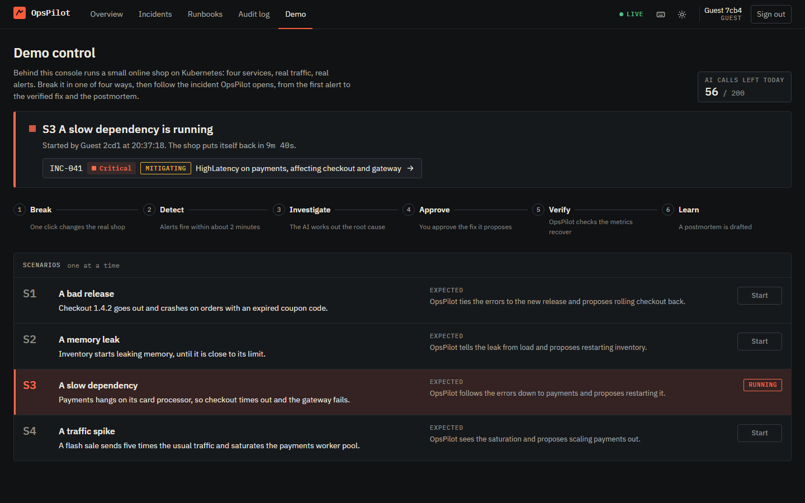
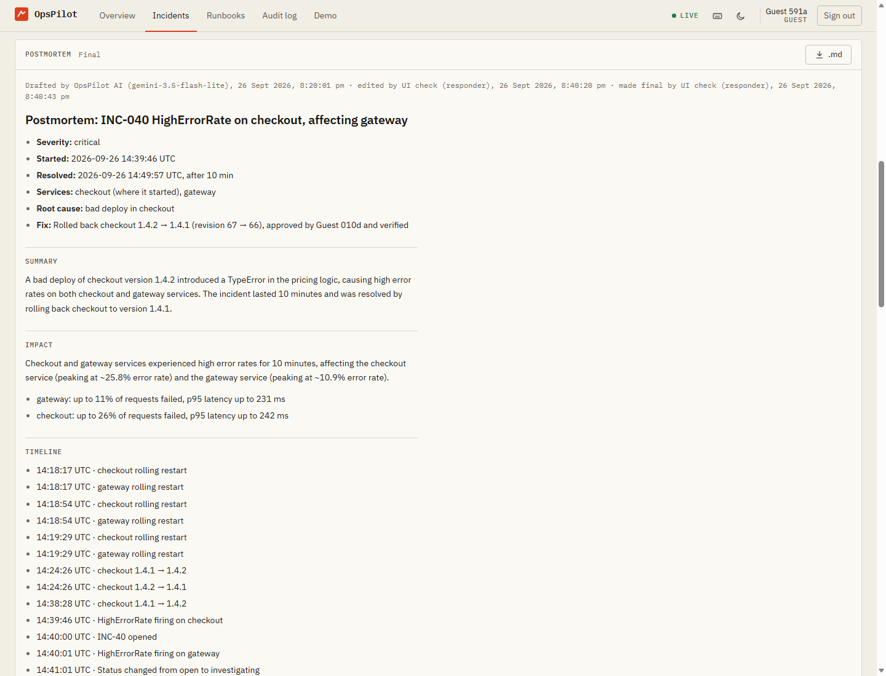
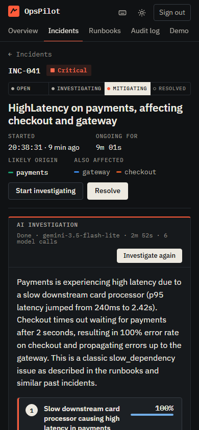

# OpsPilot

An AI incident-response copilot for Kubernetes. OpsPilot watches a running system and turns
alerts into incidents. It works out what changed and why things broke, then proposes a fix.
Once a human approves, it runs the fix, checks that it worked, and drafts the postmortem.

It comes with a small online shop to watch, and a demo page where anyone can break that
shop in one of four ways and follow OpsPilot through the incident.



## What it does

1. **Detects.** Alertmanager sends alerts to OpsPilot, which groups related alerts into one
   incident using the service dependency graph.
2. **Adds context.** It tracks every change in the cluster (deploys, scaling, config,
   restarts, Kubernetes warnings), merges them with the alerts into a single timeline, and
   works out which service a failure most likely started in and which services it reaches.
3. **Investigates.** A Gemini-powered agent queries Prometheus, Loki, Tempo and Kubernetes
   through read-only tools, then ranks root-cause hypotheses. Every claim cites the exact
   query and result behind it.
4. **Remembers.** The Markdown runbooks in [`runbooks/`](runbooks) and every resolved
   incident are embedded locally (transformers.js) and searched by meaning with Atlas Vector
   Search. Each incident shows the closest runbook sections and similar past incidents with
   what fixed them, and the agent reads both as evidence.
5. **Fixes, with approval.** From the root cause it proposes one of three actions (roll back,
   rolling restart, scale to 1–6 replicas) with the reason and the runbook section behind
   it. Nothing runs until a person approves. The fix then runs as a service account that can
   only read and patch Deployments in the shop's namespace. Afterwards OpsPilot watches the
   incident's error rate, latency, memory and saturation for three minutes before calling it
   verified. Every step lands in an append-only audit log whose records are chained by hash.
6. **Writes it up.** When the incident is resolved, OpsPilot drafts a blameless postmortem:
   the facts (times, impact, timeline, fix) come straight from the incident's data, and the
   AI writes the summary, the lessons and the action items around them. The team edits it,
   exports it as Markdown and marks it final, and the final version goes into incident
   memory for the next investigation to find.
7. **Shows it live.** A React console streams all of this as it happens: charts synced with
   the timeline, an interactive dependency map, the investigation step by step, the fix's
   rollout and verification, a searchable runbook library, the audit log and demo control.

| | |
|---|---|
|  |  |
|  |  |

## Try the demo

The public deployment has a **Try the demo as a guest** button on the sign-in page. A guest
session lasts two hours and can do everything the demo needs: start a scenario, approve a
fix, investigate a live incident. Postmortems and resets stay with the team's own
responders.

1. **Start a scenario** on the demo page. For a first run, pick S1, a bad release: checkout
   1.4.2 goes out and fails every order with an expired coupon code.
2. **Watch it get detected.** Within about two minutes the error-rate alerts fire, and the
   incident appears on the demo page and in a banner at the top.
3. **Read the investigation.** A minute later the AI starts. It reads the alerts, the
   metrics, the changes, the logs, similar past incidents and the runbooks, then names the
   root cause. Click any evidence tag (E1, E2…) to see the query and the result behind it.
4. **Approve the fix.** OpsPilot proposes rolling checkout back to 1.4.1. Approving shows
   once more what will happen, then the rollout's progress.
5. **Watch it verify.** For three minutes OpsPilot measures every service of the incident
   against its limits. Only the last minute decides.
6. **Read the postmortem.** Once the alerts have been quiet for five minutes, the incident
   resolves itself and the postmortem draft appears at the bottom of the incident page.

The shop puts itself back 20 minutes after a scenario starts, whatever happened in between,
and the next scenario can start 3 minutes after that. The other three scenarios are a
memory leak (S2, fixed by a restart), a slow dependency (S3, a restart of payments) and a
traffic spike (S4, scaling payments out).

## Architecture

```
            customers (loadgen)
                   │
┌──────────────────▼──────── shop namespace ─────────────────────┐
│ gateway ──> checkout ──> inventory, payments                    │
└───────┬───────────────────────────────┬────────────────────────┘
   traces + logs (OTLP)            /metrics scrape         Kubernetes API
        │                               │                       │
 OpenTelemetry Collector ─────────> Prometheus ──> Alertmanager │
   │            │   service graph       │              │ webhook│
 Tempo        Loki                      │              ▼        ▼
   └────────────┴──── queries ──────────┴────────> OpsPilot server ──> MongoDB Atlas
                                                   │     │    ▲        (+ Vector Search)
                                          Gemini API     │    └── runbooks/*.md, embedded
                                                         │        locally with transformers.js
                  approved fixes, as opspilot-executor ──┤
                  demo scenarios, as opspilot-demo ──────┤ REST + live events (SSE)
                  (each with its own narrow Role)        ▼
                                                  OpsPilot web console
```

Locally, the shop and the observability stack run in minikube, while the server and the
console run on the host. In the cloud, everything runs in one k3s cluster, behind Traefik
with a Let's Encrypt certificate ([DEPLOYMENT.md](docs/DEPLOYMENT.md)).

## Repository layout

```
apps/server/   OpsPilot API: ingestion, correlation, change tracking, AI investigation,
               runbook search and incident memory (src/knowledge/), fixes and their
               verification (src/remediation/), the audit log (src/audit/), postmortems
               (src/postmortems/) and demo control (src/demo/)
apps/web/      OpsPilot console (React), and the nginx that serves it in the cloud
demo/          the online shop that OpsPilot watches, plus its load generator
deploy/k8s/    Kustomize manifests: base/ for everything, overlays/local/ for minikube,
               overlays/cloud/ for the public k3s deployment
docs/          requirements, roadmap, deployment guide, acceptance record, AI evaluation
runbooks/      the shop's runbooks in Markdown, indexed by OpsPilot on every start
scripts/       local cluster, failure scenarios, dev runner, evaluation and cloud deploy
```

## Running it locally

You need Docker Desktop, minikube, kubectl and Node.js 22 or newer.

```bash
npm install
cp .env.example .env
```

Fill in `.env`: a MongoDB connection string, an admin email and password, and a free
[Gemini API key](https://aistudio.google.com/apikey). Then:

```bash
npm run cluster:up
npm run dev
```

`cluster:up` creates the cluster, deploys the shop and the observability stack, and
generates the two internal secrets in `.env`. It also copies the tokens of OpsPilot's two
service accounts there: `KUBE_EXECUTOR_TOKEN` runs approved fixes, and `KUBE_DEMO_TOKEN`
drives the demo page. `dev` starts the API on :4000 and the console on
http://localhost:5173. Sign in with the admin account from `.env`, or set `DEMO_MODE=true`
to get the guest button too.

On its first start the server downloads the embedding model (about 23 MB, cached
afterwards) and creates two Atlas Vector Search indexes, which takes a minute or two. Until
then runbook search and similar incidents say they are still starting; everything else works
right away. Your Atlas cluster's Network Access list must include your IP address.

To add or change a runbook, edit the Markdown in `runbooks/` and restart the server. Each
file has a little front matter (services, alerts, cause types, recommended actions), a
`# Title`, an introduction and `## ` sections. Only files that changed are embedded again.

| Also running | Where |
|------|-------|
| Shop API | http://localhost:18080/api/products |
| Grafana | http://localhost:13000 |
| Prometheus | http://localhost:19090 |
| Alertmanager | http://localhost:19093 |

`npm run cluster:stop` pauses the cluster, `npm run cluster:down` deletes it, and
`npm run cluster:status` shows what's running.

## Breaking things on purpose

The demo page (`g d`) starts the scenarios from the console. They also work from the
command line:

```bash
npm run scenario -- list
```

| Scenario | What happens | What OpsPilot should conclude |
|----------|--------------|-------------------------------|
| `bad-deploy` | checkout 1.4.2 ships and crashes on expired coupon codes | bad deploy of checkout, roll back |
| `memory-leak` | inventory's memory climbs toward its limit | memory leak in inventory, restart |
| `payments-latency` | payments hangs, and checkout times out waiting for it | payments is the slow dependency, restart |
| `traffic-spike` | flash-sale traffic exhausts payments' processor connections | payments is saturated, scale up |

`npm run scenario -- reset` puts everything back.

## Deploying it

The public deployment is one free VM running k3s. Traefik serves the site over HTTPS, and
only the console and its API are reachable from outside. [DEPLOYMENT.md](docs/DEPLOYMENT.md)
walks through the VM, the domain and the settings. After that it's two commands:

```bash
npm run cloud -- setup    # once: Docker and k3s on the VM
npm run cloud -- deploy   # builds the images on the VM and deploys everything
```

## Checks

```bash
npm test            # unit tests
npm run lint        # ESLint
npm run evaluate    # runs every scenario 5 times and scores the AI (writes docs/evaluation.md)
```

[REQUIREMENTS.md](docs/REQUIREMENTS.md) defines what "done" means, the
[roadmap](docs/ROADMAP.md) records how each phase was verified, and
[acceptance.md](docs/acceptance.md) maps every requirement to its evidence. The AI's
accuracy per scenario is in [evaluation.md](docs/evaluation.md).
